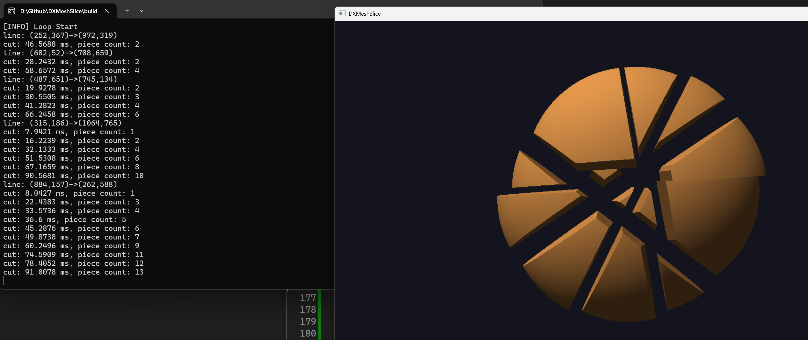

# DXMeshSlice

A small real-time mesh slicing demo written in C++ with **DirectX 11** and **DirectX 12**.
A sphere is rendered on screen. Drag the mouse across it and the sphere is cut along that line
into two pieces, each with a filled (capped) cut surface. Every new piece can be cut again, as many times as you like.

The same slicing and rendering code runs on both APIs. The API is selected from a console prompt at startup.

https://github.com/user-attachments/assets/605e5e24-734d-4c97-ac17-54cf603c8ba3



## Features

- Choose **DirectX 11** or **DirectX 12** at startup from the console
- Mouse-drag line cuts the mesh along a plane that passes through the camera and the drawn line
- Cut surfaces are capped (filled), so the pieces stay solid
- Repeated slicing: the line is applied to every piece on screen, pieces move apart after each cut
- Press `R` to reset the sphere
- Pure Win32 + DirectX, no external libraries

## Controls

| Input | Action |
| --- | --- |
| Left mouse drag | Draw a cut line, release to slice |
| `R` | Reset to a whole sphere |

## Build

Requirements:

- Windows 10/11
- Visual Studio 2022 (Desktop development with C++ workload)
- CMake 3.20+
- Windows SDK 10.0.26100.0 (or adjust `CMAKE_SYSTEM_VERSION` in `CMakeLists.txt`)

```bat
git clone https://github.com/HekSeon/DXMeshSlice.git
cd DXMeshSlice
mkdir build
cd build
cmake ..
cmake --build . --config Debug
```

You can also open the folder directly in Visual Studio (CMake project) and run it from there.
The repository includes `generate.bat` and `clean.bat` helper scripts for generating and cleaning the build directory.

Run `DXMeshSlice.exe` from a console. It asks which API to use:

```
Graphic API selector:
 1 - DirectX 11
 2 - DirectX 12
```

## How it works

### Rendering abstraction

The application only talks to an `IRenderer` interface. `DirectX11Renderer` and `DX12Renderer` implement it,
and `RendererFactory` returns the one chosen at startup. Mesh data (`Mesh`, `Vertex`) contains no DirectX types.

```
IRenderer
 ├── DirectX11Renderer
 └── DX12Renderer
```

Both renderers share the same HLSL source (`ShaderSource.h`) and the same constant layout (world, view, projection),
so a sphere looks identical on both APIs. The DX12 path uses root constants for the matrices and a fence to wait for the GPU each frame.

### Slicing algorithm

1. **Line to plane.** The two ends of the mouse line are converted from screen space to world-space rays.
   The camera position and the two ray directions define a plane; its normal is the cross product of the two directions.
2. **Plane to piece space.** Pieces are translated, so the plane's distance is shifted by the piece offset to get a local plane.
3. **Triangle classification.** Each vertex gets a signed distance to the plane. Triangles are either fully on one side,
   or cut: the two crossing edges are intersected with the plane, producing one triangle on one side and a quad (two triangles) on the other.
4. **Capping.** The intersection points form the cut outline. Duplicates are merged, points are sorted by angle around their center,
   and a triangle fan is built with flat normals facing outward on each half.
5. **Repeat.** Each resulting half becomes its own piece with its own GPU buffers and can be cut again.

## Project structure

```
src/
 ├── main.cpp              application loop, line to plane conversion
 ├── Window.h/.cpp         Win32 window, mouse line capture
 ├── IRenderer.h           renderer interface
 ├── RendererFactory.*     creates DX11 or DX12 renderer
 ├── Mesh.h                Vertex and Mesh (CPU side)
 ├── SphereGenerator.*     UV sphere generation
 ├── Plane.h               plane and signed distance
 ├── MeshSlicer.*          triangle slicing and cap generation
 ├── ShaderSource.h        shared HLSL source
 ├── Log.h                 console logging helpers
 ├── DX11/                 DirectX 11 renderer
 └── DX12/                 DirectX 12 renderer
```

## Known limitations

- DX12 renderer waits for the GPU every frame and when meshes are uploaded or removed (simple and safe, not optimized)
- Meshes are uploaded through upload heaps on DX12 instead of default heaps
- Pieces are only translated apart, no physics
- Many cuts increase the vertex count; very high tessellation may slow down repeated slicing

## Possible next steps

- Draw the cut line on screen while dragging
- Frames in flight on DX12
- Physics for falling pieces

## License

No license specified yet.
